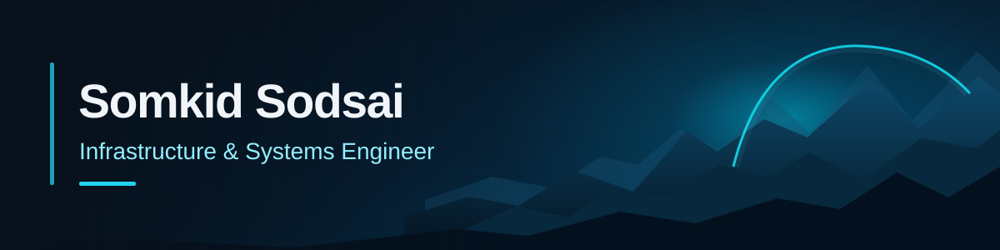
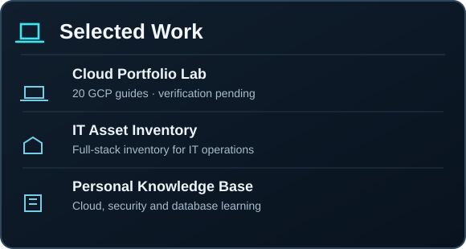
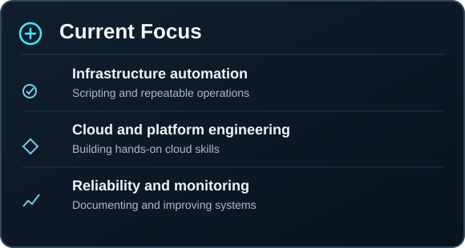

<table>
<tr>
<td width="62%" valign="top">

### About me

I work with **enterprise infrastructure and operations**, including Windows and Linux servers, Solaris, VMware, databases, storage, and backup.

I enjoy building reliable systems, troubleshooting issues, automating repetitive work, and writing documentation that others can actually use.

</td>
<td width="38%" valign="top">

### My focus

⚙️ Infrastructure · Operations · Automation

🛡️ Reliability · Security · Monitoring

☁️ Cloud · DevOps · Platform Engineering

</td>
</tr>
</table>

### Tools & Technologies

Tools I use for infrastructure work, scripting, and hands-on cloud learning.

<table>
<tr>
<td align="center" width="7%"> Windows</td>
<td align="center" width="7%"> Linux</td>
<td align="center" width="7%"> Ubuntu</td>
<td align="center" width="7%"> Red Hat</td>
<td align="center" width="7%"> Oracle</td>
<td align="center" width="7%"> SQL Server</td>
<td align="center" width="7%"> PowerShell</td>
<td align="center" width="7%"> Bash</td>
<td align="center" width="7%"> Git</td>
<td align="center" width="7%"> Docker</td>
<td align="center" width="7%"> Python</td>
<td align="center" width="7%"> Azure</td>
<td align="center" width="7%"> Google Cloud</td>
</tr>
</table>
Also: VMware vSphere/ESXi · Solaris · IIS · enterprise storage · backup systems · AWS learning

 

<table>
<tr>
<td width="50%" valign="top">

**Selected work**

- [Cloud Portfolio Lab](https://github.com/somkid-s5/Portfolio-Lab) — 20 guide-ready GCP labs; deployment verification pending
- [IT Asset Inventory](https://github.com/somkid-s5/IT-Asset-Inventory) — inventory system for IT operations
- [Personal Knowledge Base](https://github.com/somkid-s5/Personal-Knowledge-Base) — structured technical learning materials

</td>
<td width="50%" valign="top">

**Currently working toward**

- Improving infrastructure automation and repeatable operations
- Developing practical cloud and DevOps skills through hands-on labs
- Strengthening monitoring, troubleshooting, and technical documentation

</td>
</tr>
</table>

**Build · Automate · Improve**

Thailand 🇹🇭 · <a href="https://github.com/somkid-s5?tab=repositories">Explore all repositories ↗</a>

