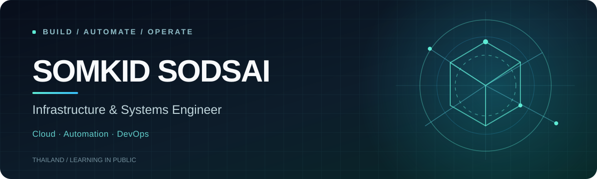

 

**Hello, I'm Smart.** I build, maintain, and improve infrastructure — and turn what I learn into practical projects.

🇹🇭 Thailand · System Administration · Infrastructure Engineering · Exploring Cloud &amp; Platform Engineering

  

<a href="https://github.com/somkid-s5/Portfolio-Lab"><strong>Explore cloud labs ↗</strong></a>
&nbsp;&nbsp;·&nbsp;&nbsp;
<a href="https://github.com/somkid-s5/Personal-Knowledge-Base"><strong>Read my notes ↗</strong></a>
&nbsp;&nbsp;·&nbsp;&nbsp;
<a href="https://github.com/somkid-s5?tab=repositories"><strong>All projects ↗</strong></a>

 

## A little about me

I'm a **System Administrator working with enterprise infrastructure** — Windows and Linux servers, Solaris, VMware, databases, storage, and backup. I enjoy troubleshooting real systems, automating repetitive tasks, and keeping clear technical documentation.

My next chapter is **DevOps / Platform Engineering**, with a focus on practical cloud skills, monitoring, automation, and reliable delivery.

> **How I learn:** Understand the problem → build a solution → test it → document the result.

## Tools & technologies

Instead of listing every tool I've ever tried, these are the technologies I work with or actively study.

**Systems & infrastructure**

  &nbsp;&nbsp;&nbsp;
  &nbsp;&nbsp;&nbsp;
  &nbsp;&nbsp;&nbsp;
  &nbsp;&nbsp;&nbsp;
  &nbsp;&nbsp;&nbsp;
  &nbsp;&nbsp;&nbsp;
  

**Automation & developer tools**

  &nbsp;&nbsp;&nbsp;
  &nbsp;&nbsp;&nbsp;
  &nbsp;&nbsp;&nbsp;
  &nbsp;&nbsp;&nbsp;
  &nbsp;&nbsp;&nbsp;
  

**Cloud learning journey**

  &nbsp;&nbsp;&nbsp;
  &nbsp;&nbsp;&nbsp;
  

Also working with Solaris, VMware ESXi, IIS, enterprise storage, backup systems, and operational monitoring.

 

## Selected work

### ☁️ [Cloud Portfolio Lab](https://github.com/somkid-s5/Portfolio-Lab)
**Cloud engineering · GCP · Documentation**

20 Google Cloud solution lab guides with architecture material, implementation steps, verification plans, and cleanup instructions. **Documentation is guide-ready; real cloud deployment verification is still pending.**

### 🗂️ [SysOps — IT Asset Inventory](https://github.com/somkid-s5/IT-Asset-Inventory)
**Next.js · NestJS · PostgreSQL · VMware integration**

An IT inventory registry for hardware assets, virtual machines, databases, and technical documentation, designed around structured inventory and access control.

### 📚 [Personal Knowledge Base](https://github.com/somkid-s5/Personal-Knowledge-Base)
**AWS · Azure · Google Cloud · Security · Oracle**

My growing collection of structured technical study materials, hands-on labs, diagrams, and troubleshooting notes.

### ⚙️ [DevOps Project Solutions](https://github.com/somkid-s5/devops-project)
**Linux · SSH · Nginx**

Practical server administration exercises, including remote SSH server setup and static website hosting.

 

## Right now

- Building deeper skills in **cloud architecture, automation, and CI/CD**
- Improving how I **monitor, troubleshoot, and document** complex systems
- Turning hands-on infrastructure knowledge into a stronger **DevOps / Platform Engineering portfolio**

 

<strong>Build with purpose. Test with evidence. Keep learning.</strong>

